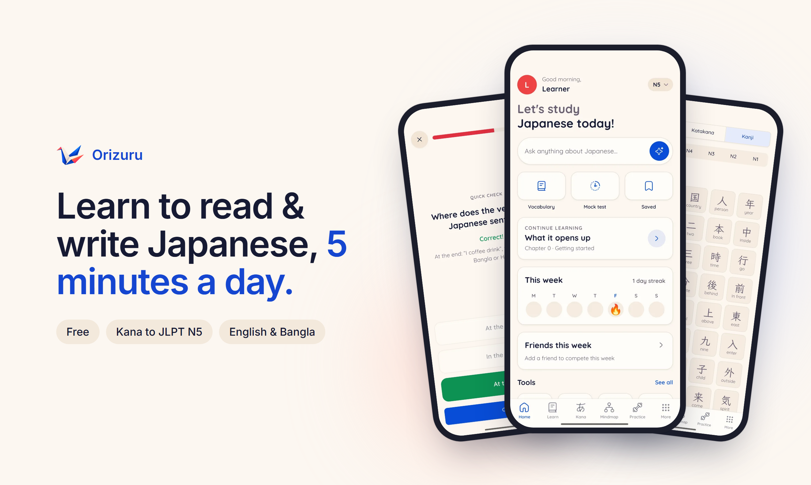
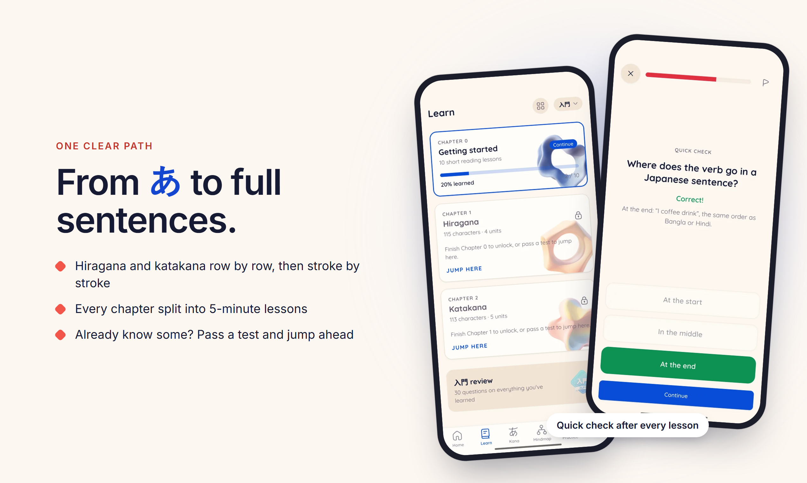
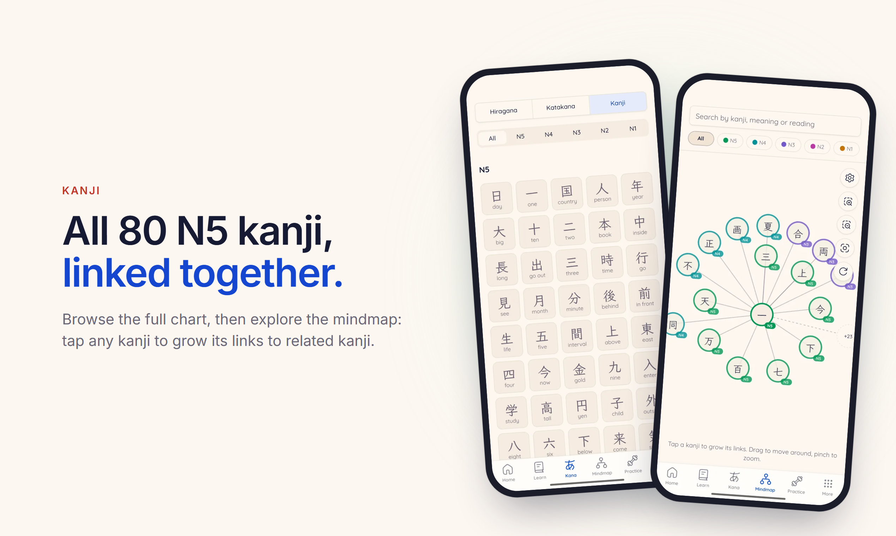
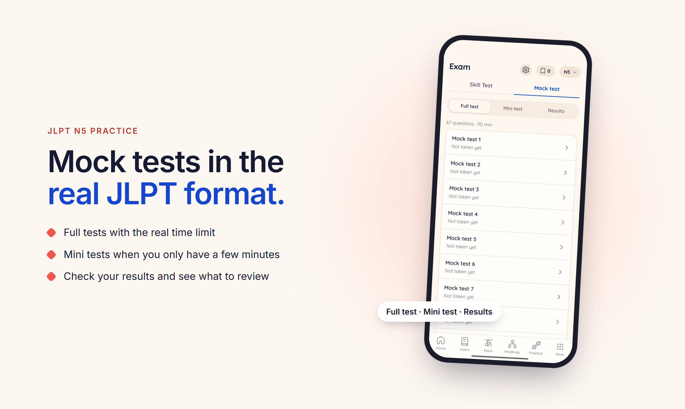
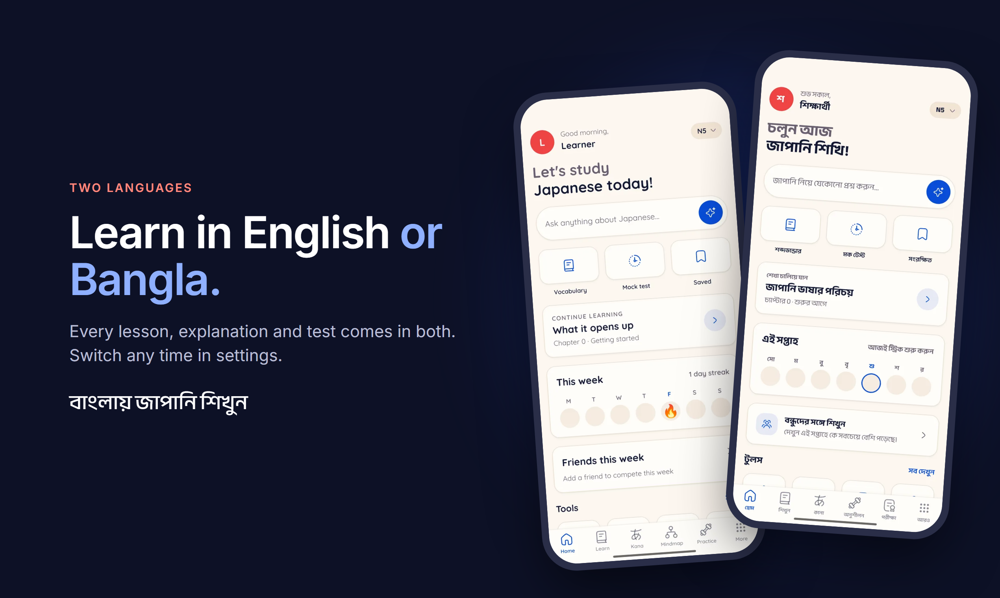
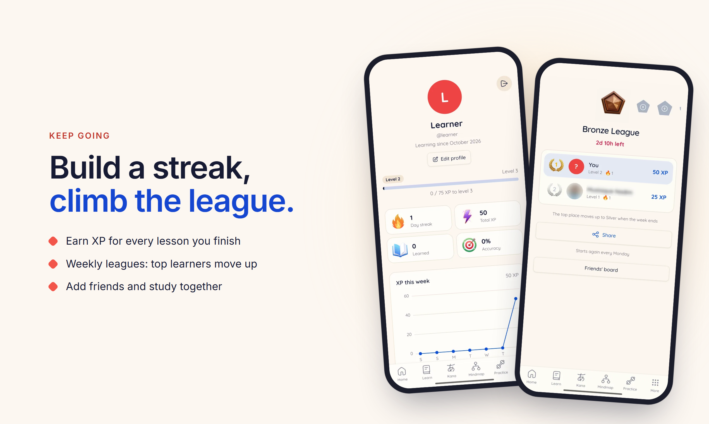

# Orizuru 折鶴

**Learn Japanese from zero to JLPT N5, in English or Bangla.**

**বাংলায় জাপানি শিখুন: শূন্য থেকে JLPT N5 পর্যন্ত।**

[Get it on Google Play](https://play.google.com/store/apps/details?id=fyi.orizuru.app) · [Website](https://orizuru.fyi) · [Product Hunt](https://www.producthunt.com/products/orizuru) · [News](https://orizuru.fyi/news)

Orizuru is a free Android app for learning Japanese. It is written for Bangla- and English-speaking learners, many of whom live in Japan or are moving there for work or study. It takes you from your first hiragana to the JLPT N5 exam in short, five-minute lessons.

## What's inside

- **A full course from 入門 to N5:** 24 chapters with hiragana, katakana, 1,389 words, all 80 N5 kanji and 71 grammar points.
- **Stroke order and writing:** every kana and kanji lesson shows the strokes and has you write the character.
- **Daily review:** spaced repetition (FSRS) brings each word, kana, kanji and grammar point back just before you would forget it.
- **JLPT N5 exam practice:** 20 full mock tests and 20 mini tests in the official format, with timed sections and listening.
- **AI explanations and an AI tutor:** ask why an answer is right, or ask anything about Japanese, in English or Bangla. You can send a photo or ask by voice.
- **Kanji mindmap:** tap a kanji to see the kanji it is linked to.
- **Tools for life in Japan:** a halal ingredient checker, a translator, a yen-to-taka converter and emergency phrases.
- **Streaks, weekly leagues and friends** to keep you studying.
- **Works offline first:** progress is saved on your phone. Signing in is optional and syncs your progress across devices.

## Screenshots

## বাংলায়

Orizuru একটা ফ্রি অ্যান্ড্রয়েড অ্যাপ। বাংলাভাষী শিক্ষার্থীরা এতে শূন্য থেকে JLPT N5 পর্যন্ত জাপানি ভাষা শিখতে পারেন। যাঁরা জাপানে থাকেন বা কাজ কিংবা পড়াশোনার জন্য জাপানে যাচ্ছেন, অ্যাপটা তাঁদের কথা ভেবে বানানো।

- হিরাগানা, কাতাকানা, ১,৩৮৯টি শব্দ, N5-এর ৮০টি কাঞ্জি আর ৭১টি ব্যাকরণ পয়েন্ট
- প্রতিদিন পাঁচ মিনিটের ছোট পাঠ, প্রতিটার শেষে ছোট পরীক্ষা
- আসল JLPT ফরম্যাটে ২০টি পূর্ণ মক টেস্ট আর ২০টি মিনি টেস্ট
- বাংলায় AI ব্যাখ্যা আর AI শিক্ষক
- জাপানে দৈনন্দিন জীবনের টুল: হালাল উপাদান যাচাই, অনুবাদক, ইয়েন থেকে টাকা আর জরুরি বাক্য

[Google Play থেকে নামান](https://play.google.com/store/apps/details?id=fyi.orizuru.app)

## Feedback

Found a mistake in a lesson or question, or have an idea? [Open an issue](../../issues). You can also report a question from inside the app.

---

This repository holds the app's public page. The app's source code is not published here. Screenshots and app content © Orizuru, all rights reserved.
